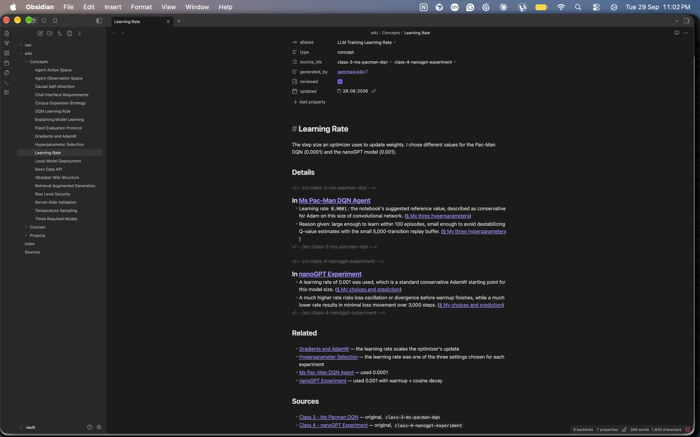
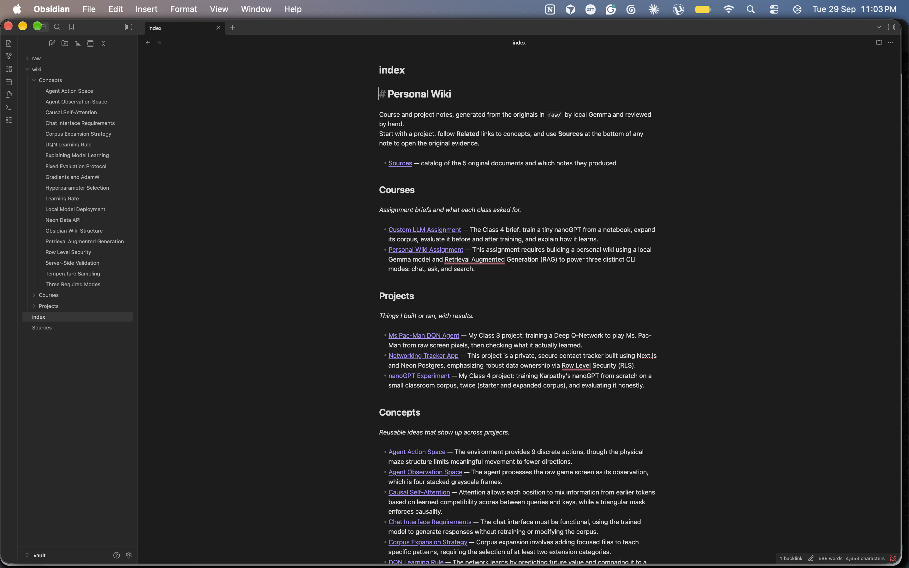
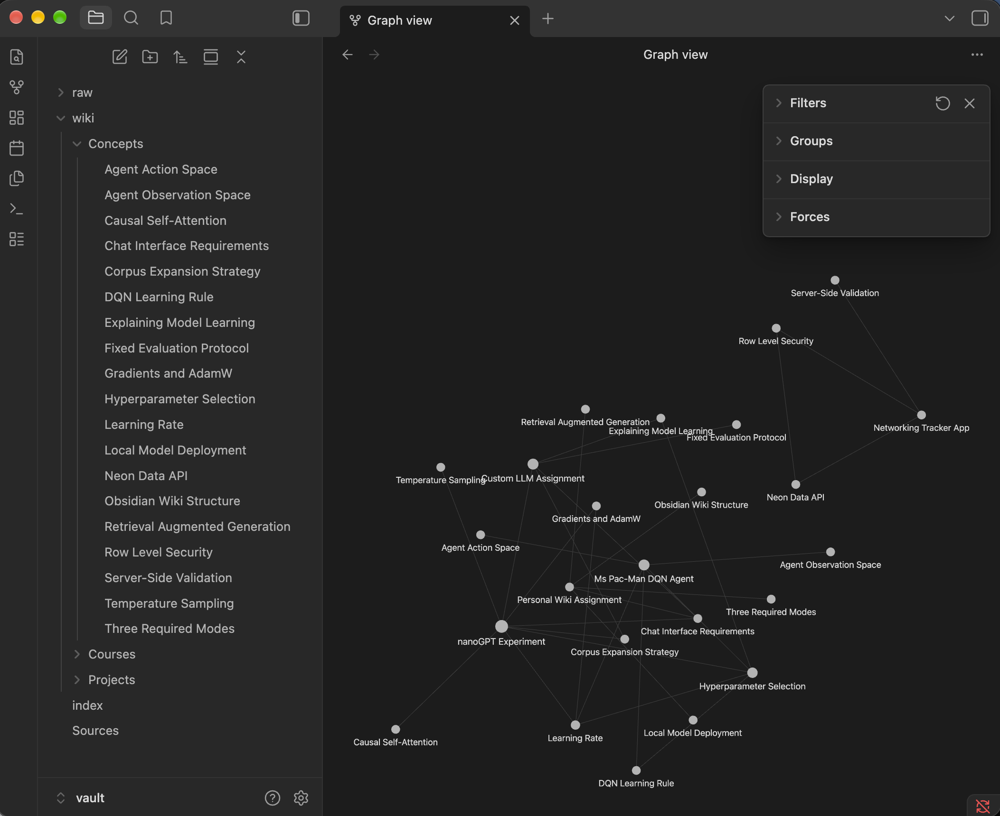

# Personal Wiki: Local Gemma + RAG

Class 5 · Assignment 4. A command-line tool (`wiki`) that turns my course and project notes into an Obsidian wiki, and answers questions about them with **Gemma 4 E4B running locally through Ollama**, fully offline. I wrote the harness myself (about 1,400 lines of Python, only `numpy` as a dependency). Nothing is sent to a cloud service.

| Jump to | |
|---|---|
| 🧪 Four ask-mode evidence cards (offline) | [test1](evidence/offline/ask/test1.md) · [test2](evidence/offline/ask/test2.md) · [test3](evidence/offline/ask/test3.md) · [test4](evidence/offline/ask/test4.md) |
| 💬 Chat / search / ask mode checks (offline) | [evidence/offline/mode-checks.md](evidence/offline/mode-checks.md) · [ask ignores chat](evidence/offline/ask-chat-claim.md) · [search output](evidence/offline/search-learning-rate.md) |
| 📴 Offline recording | [terminal-recording.txt](evidence/offline/terminal-recording.txt) · [Wi-Fi off](evidence/screenshots/offline-1-wifi-off.png) · [run finished](evidence/screenshots/offline-2-demo-finished.png) |
| 🗂️ Obsidian screenshots | [note](evidence/screenshots/obsidian-1-note-learning-rate.png) · [index](evidence/screenshots/obsidian-2-index.png) · [graph](evidence/screenshots/obsidian-3-graph.png) |
| 📏 Memory and speed | [evidence/perf.md](evidence/perf.md) |
| 🧭 The wiki | [vault/index.md](vault/index.md) · [vault/Sources.md](vault/Sources.md) |
| 🛠️ Harness code | [pwiki/](pwiki/) · [prompts/](prompts/) |

---

## 1. Purpose and sources

**What the wiki is for:** one place to look up what I did and learned in my AI course projects: the settings I chose, the results, what went wrong, and what each assignment required. I can browse it in Obsidian, or ask it a question and get an answer with citations.

**Sources** (the originals are in [`vault/raw/`](vault/raw/), byte-for-byte copies; SHA-256 hashes are in [`vault/Sources.md`](vault/Sources.md) and [`data/sources.json`](data/sources.json)):

| Raw file | Where it came from |
|---|---|
| `Class 3 - Ms Pacman DQN.md` | my Class 3 repo README (Deep Q-Network on Ms. Pac-Man) |
| `Class 4 - nanoGPT Experiment.md` | my Class 4 repo README (training nanoGPT from scratch) |
| `Class 4 - Assignment Brief.md` | the Class 4 course brief |
| `Networking Tracker Project.md` | README of my Networking Tracker web app (Next.js + Neon Postgres) |
| `Class 5 - Personal Wiki Brief.md` | a **condensed** copy of this assignment's text (key sections, not verbatim). Held back and ingested only during the offline demo |

**How originals connect to generated pages:** `wiki ingest` sends one raw file to Gemma, which proposes one main note (a project or course) plus 2–4 concept notes. Every bullet in a note ends with a link to the exact heading in the original, such as `([[raw/Class 3 - Ms Pacman DQN#My three hyperparameters|§ My three hyperparameters]])`, and every note has a **Sources** section. The machine ID (e.g. `class-3-ms-pacman-dqn`) is stored in the note's `source_ids` property and in the source catalog, never in a filename.

**The wiki today:** 24 notes in [`wiki/Projects`](vault/wiki/Projects/) (3), [`wiki/Courses`](vault/wiki/Courses/) (2) and [`wiki/Concepts`](vault/wiki/Concepts/) (19); 0 broken links, 0 duplicate or machine-style names (`wiki check`). Example cross-source note: [Learning Rate](vault/wiki/Concepts/Learning%20Rate.md) compares the value I chose in the Pac-Man project (0.0001) and the nanoGPT project (0.001), each linked to its source section.

## 2. Setup and device

### Device (measured)

| | |
|---|---|
| OS | macOS 27.0 |
| Chip | Apple M1: 8-core CPU (4 performance + 4 efficiency), 8-core GPU, Metal 4 |
| Memory | **16 GB unified memory** (CPU and GPU share it; no separate VRAM). About 34% free during runs, with ~5 GB swap in use from other apps |
| Free disk | ~138 GB free of 460 GB |
| Python | 3.12.0 (numpy 2.5.3) |
| Runtime | **Ollama 0.34.3** (llama.cpp backend, 100% GPU per `ollama ps`) |
| Obsidian | 1.13.7 |

### Models

| Role | Ollama tag | Details | Official source |
|---|---|---|---|
| Chat / answers / ingest | **`gemma4:e4b`** (digest `c6eb396dbd59`) | Gemma 4 E4B, 8.0B total params, **Q4_K_M** 4-bit quantization, GGUF, 9.6 GB download | [ollama.com/library/gemma4](https://ollama.com/library/gemma4) · [Gemma docs](https://ai.google.dev/gemma/docs/core) |
| Embeddings (retrieval) | `embeddinggemma` (digest `85462619ee72`) | EmbeddingGemma 308M, BF16, 621 MB | [ollama.com/library/embeddinggemma](https://ollama.com/library/embeddinggemma) |
| Comparison only | `gemma4:e2b` (digest `7fbdbf8f5e45`) | Gemma 4 E2B, Q4_K_M | same |

Model weights are **not** in this repository; Ollama stores them in `~/.ollama`.

### Why E4B fits this computer

- The assignment's guidance for a 16 GB Mac is "E2B or E4B". Measured E4B memory is **3.3–3.4 GB** loaded, plus 0.67 GB for embeddings, **≈4.1 GB total**, leaving plenty for macOS and apps. The 26B MoE (~14.4 GB) would not leave enough room.
- I ran the same four questions on E2B and E4B ([perf.md](evidence/perf.md#e2b-vs-e4b-on-the-same-4-questions-dev-run-after-the-retrieval-fixes)). E2B is 2.5× faster (≈20–26 s vs 42–77 s) but missed the causes in the paraphrased "why" question (test 2). **E4B is the smallest model that passed all four**, so it's the default.

### Measured performance (offline run)

- **Ask:** 45–66 s per question end-to-end (≈2.3–3k prompt tokens of evidence). Most of that is prompt reading on the M1 GPU; retrieval takes <1 s.
- **Ingest:** 236 s for the Class 5 brief (2.9k prompt tokens, 1.4k output tokens). The first ingest of the 4 original sources took 21 min.
- **Memory:** E4B 3.3–3.4 GB + embeddings 0.67 GB; the Python harness itself peaks at ~37 MB. Details: [evidence/perf.md](evidence/perf.md).

### Install (online, once)

```bash
brew install ollama            # or the installer from ollama.com
ollama serve                   # leave running in its own terminal tab
ollama pull gemma4:e4b
ollama pull embeddinggemma
git clone <this repo> personal-wiki && cd personal-wiki
python3 -m venv .venv && .venv/bin/pip install -e .
```

After that, everything works with the internet off.

### Commands

```bash
.venv/bin/wiki --help                                     # commands, config, requirements
.venv/bin/wiki ingest vault/raw                           # generate/update notes from every raw source
.venv/bin/wiki ingest "staging/Class 5 - Personal Wiki Brief.md"   # add one new source
.venv/bin/wiki search "learning rate" --scope raw         # original passages only, no model
.venv/bin/wiki ask "What learning rate did I use for the nanoGPT experiments?" --passages
.venv/bin/wiki chat                                       # Wren, the assistant (/search, /save, /clear, /exit)
.venv/bin/wiki eval                                       # the 4 test questions -> evidence cards
.venv/bin/wiki check                                      # broken links, bad names, duplicates, heading mismatches
.venv/bin/wiki rename "Old Title" "New Title"             # rename a note + fix every link to it
```

Configuration is through environment variables: `WIKI_MODEL` (default `gemma4:e4b`), `WIKI_EMBED_MODEL`, and `OLLAMA_HOST` (default `http://127.0.0.1:11434`). `--mode local` is the only mode; there is no online mode.

**Errors:** if Ollama isn't running, `ask`/`chat`/`ingest` print `error: local model unavailable — Can't reach Ollama at … Start it with: ollama serve`. A model that isn't downloaded gives `Run (while online): ollama pull <model>`. `search` still works with the model down (it falls back to keyword-only and says so). A missing file or index gives a one-line hint instead of a traceback.

**Open the wiki:** in Obsidian, choose *Open folder as vault* and pick **`vault/`** (not the repo root). Graph filter used for the screenshot: `path:wiki/`, Attachments off.

## 3. Architecture: model, retrieval tool, RAG workflow, harness, CLI

| Piece | What it is here | Code |
|---|---|---|
| **Model** | Gemma 4 E4B in Ollama. It only sees what the harness puts in `messages`; it never reads files, remembers past sessions, or runs tools by itself. | [`pwiki/llm.py`](pwiki/llm.py) (stdlib HTTP to 127.0.0.1) |
| **Retrieval tool** | Finds evidence passages. It never calls the chat model. | [`chunking.py`](pwiki/chunking.py), [`index.py`](pwiki/index.py), [`retrieval.py`](pwiki/retrieval.py) |
| **RAG workflow** | Retrieve → label passages → research rules + passages + question → Gemma → citation check. Used by **ask**. | [`modes/ask.py`](pwiki/modes/ask.py), [`citations.py`](pwiki/citations.py) |
| **Harness** | Everything around the model: which mode runs, which instructions load, conversation history, whether to retrieve, prompt assembly, model calls, citation checks, errors, saved evidence. | [`modes/`](pwiki/modes/), [`prompts.py`](pwiki/prompts.py), [`ingest.py`](pwiki/ingest.py), [`notes.py`](pwiki/notes.py), [`evidence.py`](pwiki/evidence.py) |
| **CLI** | Parses the command and hands it to the harness. | [`pwiki/cli.py`](pwiki/cli.py) |

### How the harness keeps the three modes different

| | search | ask | chat |
|---|---|---|---|
| Instructions loaded | none | [`prompts/wiki-instructions.md`](prompts/wiki-instructions.md) (research rules) | [`prompts/persona.md`](prompts/persona.md) (Wren's voice + real capabilities) |
| Conversation history | none | **none**: every question is standalone | last 12 messages |
| Retrieval | always, and that's all it does | always: top 8 **raw** passages (original evidence only) | **only if Gemma calls the `search_notes` tool**, or the user types `/search` |
| Model call | none | 1 call, temperature 0 | 1 call, or 2 if the tool is used; temperature 0.6 |
| Output | passages + path + section + lines + scores | answer + `[S#]` citations resolved to file § section (lines) + citation check | reply + a trace line: `· no notes searched` or `· Gemma called search_notes: "…" → 5 passages` |

Chat history is never passed to ask, and `/save` in chat writes drafts to `outputs/drafts/`, which is outside the vault and never indexed. So generated text can't become "evidence".

### One question traced through the code

`wiki ask "What learning rate did I use for the nanoGPT experiments?"`

1. **CLI:** [`cli.py`](pwiki/cli.py) `main()` parses `ask`, and `_dispatch` calls `modes.ask.run(question)`.
2. **Load index:** `Retriever()` reads `data/index/chunks.jsonl` (218 passages with path, heading trail and line range) and `embeddings.npy`, then builds BM25 statistics in memory.
3. **Retrieve:** `search()` tokenizes the question (stop words removed, plurals folded, bigrams like `learning_rate` added) and scores every passage with BM25. It embeds the question with `embeddinggemma` (one local HTTP call) and computes cosine similarity. Reciprocal-rank fusion merges the two rankings, `_diversify` keeps the best 8 with at most 3 per file, and only `kind == "raw"` passages are used.
4. **Expand:** `expand()` extends the top 3 passages through the rest of their section if the chunker split it.
5. **Gate:** if nothing matches at all (no BM25 hit and cosine < 0.30), the harness answers INSUFFICIENT EVIDENCE itself without calling Gemma.
6. **Prompt:** `format_passages` labels passages `[S1]…[S8]` with path, section and lines. `prompts.ask_messages` builds `system = wiki-instructions.md` and `user = passages + question`. No persona, no history.
7. **Model:** `llm.chat()` POSTs to `http://127.0.0.1:11434/api/chat` with `temperature 0, num_ctx 8192, think false`. That's about 2.8k tokens in and 40 out.
8. **Check:** a regex removes LaTeX wrappers around numbers. `citations.check()` parses every `[S#]`, flags labels that weren't provided, and flags answers with no citations (unless they're INSUFFICIENT EVIDENCE).
9. **Show and save:** `ask.render()` prints the answer, `Sources: [S5] raw/Class 4 - nanoGPT Experiment.md § … > My choices and prediction (L12-36)`, and the model and timing. With `--save`/`eval`, `evidence.ask_card()` writes a Markdown card containing the passages, model digest, network status, timings and citation check.

### Ingest pipeline

[`ingest.py`](pwiki/ingest.py):
1. Copy the file into `vault/raw/` if needed. An existing raw file with different content is never overwritten.
2. SHA-256 it, and skip it if unchanged (`--force` regenerates).
3. Send the **whole document** (all sources are under 10k tokens; `num_ctx` 16384), its heading list, and the list of existing notes to Gemma with [`prompts/ingest-instructions.md`](prompts/ingest-instructions.md), requesting JSON output at temperature 0.
4. The code then enforces what the model can't be trusted with:
   - **Titles:** 1–6 words, Title Case, rejecting hashes, dates, "Class 4", `.md` and questions.
   - **Folders:** only Projects/Courses/Concepts.
   - **Section links:** each key point's section name must match a real heading.
   - **Cross-source links:** a link to a note from a *different* source is kept only if that note's subject appears in this source's text.
   - Links to notes that don't exist are removed.
5. Each source's content goes between `<!-- src:ID -->` markers inside a note, so re-ingesting replaces its own block instead of appending a duplicate. Notes marked `reviewed: true` keep their reviewed text.
6. Rewrite `index.md` and `Sources.md`, then rebuild the retrieval index.

## 4. Design choices

- **Passage size:** ~220 words with 40 words of overlap. Cuts happen at headings first and never inside a line, so tables and bullets stay whole. Each passage keeps its path, heading trail ("Parent > Child") and line range, so citations point to lines you can check.
- **How much text reaches Gemma:** ask sends 8 passages (≈1,500–1,900 words ≈ 2.3–3k tokens) in an 8,192-token context. Chat sends 5 passages when it searches. Ingest sends one whole source (≤9.7k tokens) in a 16,384-token context. The whole wiki is never sent.
- **Retrieval method:** hybrid **BM25 (my own ~30-line implementation) + EmbeddingGemma cosine, fused with reciprocal-rank fusion**. BM25 catches exact terms like `0.001` and `DQN`; embeddings catch paraphrases like "staying alive" vs "survival". Both are local.
- **Research rules** ([`wiki-instructions.md`](prompts/wiki-instructions.md)):
  - use only the passages
  - cite every factual sentence
  - neutral voice
  - an exact `INSUFFICIENT EVIDENCE:` first line when the answer isn't there
  - rubrics and instructions are not outcomes (added because my notes contain grading criteria that look like an answer to "what grade did I get?")
- **Assistant personality** ([`persona.md`](prompts/persona.md)): "Wren", a brief, warm study partner. The persona lists what she can and can't actually do. Her own ideas are labeled as suggestions, facts from the notes are cited, and she never invents personal facts.
- **When chat retrieves:** Gemma decides through Ollama's native tool calling (`search_notes(query)`). The persona says to call it when a reply depends on my notes, and not for greetings, questions about Wren, or rewriting earlier replies. `/search <query>` forces it. Every turn prints whether retrieval happened.
- **Note naming and folders:** notes are named for their subject in 2–5 words ("Learning Rate", "Row Level Security"), and the first heading always equals the filename (`wiki check` verifies this). There are only three topic folders: `Projects/` (things I built), `Courses/` (assignment briefs) and `Concepts/` (reusable ideas). Code, index files, answer keys and evidence all live **outside** `vault/`.
- **Source IDs → readable pages:** `data/sources.json` maps each source ID to its raw file, original location, hash and the note titles it produced. Every note stores its `source_ids`. Renames keep the old name as an `alias`.
- **Re-ingestion without duplicates** (tested; see §5):
  - an unchanged hash means skip
  - a changed or forced source is matched to existing notes by title, then alias, then the source ID for its main note, and for concepts from the same source, by ≥50% title-word overlap
- **Model settings that mattered:**
  - `think: false`: Gemma 4's "thinking" mode would add hidden tokens and time.
  - `temperature 0` for ask and ingest, so reruns are repeatable.
  - `format: json` for ingest.
  - `num_ctx` 8192/16384.

## 5. Evidence

All required runs used **`gemma4:e4b` · Q4_K_M · digest `c6eb396dbd59` · Ollama 0.34.3 · local**, on the device above, with the 5 sources listed in §1. Every card records its network status. The required runs below all say **OFFLINE (internet unreachable)**.

### Offline demonstration (2026-09-29, 22:24–22:34)

I turned Wi-Fi off ([screenshot](evidence/screenshots/offline-1-wifi-off.png)), then ran [`scripts/offline_demo.sh`](scripts/offline_demo.sh) under `script` and `caffeinate`. The full terminal recording is in [terminal-recording.txt](evidence/offline/terminal-recording.txt). The run did the following, in order:

1. **Proved there was no internet:** `networksetup` reported "Wi-Fi Power: Off", `curl google.com` failed with "Could not resolve host", and `ping 1.1.1.1` failed with "No route to host".
2. **Restarted the model** (`ollama stop`) and ran `wiki --help`.
3. **Ingested a new source offline:** the Class 5 brief produced 5 new notes in 236 s. A second `wiki ingest vault/raw` reported "0 source(s) processed" (no duplicates), and `wiki check` reported 24 notes with 0 broken links, 0 machine-style names, 0 duplicates and 0 heading mismatches.
4. **Searched:** `wiki search "learning rate"` ([output](evidence/offline/search-learning-rate.md)).
5. **Ran the four ask tests** (below).
6. **Ran the ask-after-chat-claim test and the chat mode checks.**
7. **Finished** ([screenshot of the end](evidence/screenshots/offline-2-demo-finished.png); the Wi-Fi icon is still crossed out at 22:35).

### The four ask-mode tests

The questions and expected evidence were written **before** retrieval was built, in [`evals/questions.json`](evals/questions.json), which is outside the vault and never indexed.

| # | Question | Expected evidence | Retrieved? | Gemma's answer (short) | Citations check out? | Verdict |
|---|---|---|---|---|---|---|
| [1](evidence/offline/ask/test1.md) | What learning rate did I use for the nanoGPT experiments? | nanoGPT README, *My choices and prediction* | ✅ [S5] | "0.001 … with built-in warmup + cosine decay" | ✅ cites my README (lines 34–35), not the brief that *recommends* 0.001 | **Pass** |
| [2](evidence/offline/ask/test2.md) | Why didn't my Pac-Man agent get better at staying alive even after much longer training? *(paraphrased)* | Pac-Man README, *Limitation and next experiment* | ✅ [S2] (whole section) | sticky actions (25%), grayscale hides the blue-ghost cue, harder credit assignment for a 5,000-transition buffer; score doubled but lifespan didn't | ✅ every claim is in S2 (L62–74) or S1 | **Pass** |
| [3](evidence/offline/ask/test3.md) | Compare the learning rates I chose for the Pac-Man DQN and the nanoGPT model. *(two sources)* | both READMEs' hyperparameter sections | ✅ [S2] + [S8] | DQN 0.0001 ("conservative for Adam"); nanoGPT 0.001 with warmup + cosine decay | ✅ each number cites its own README | **Pass** |
| [4](evidence/offline/ask/test4.md) | What grade did I receive on the Class 3 Pac-Man assignment? *(unsupported)* | none: no source states a received grade | grading *criteria* passages only | "INSUFFICIENT EVIDENCE: the notes do not say what grade was received…" | ⚠️ its extra sentence claims the 4/3/3 rubric applies to "Class 3", but the cited passages are about Classes 4 and 5 | **Pass, with a minor flaw** |

Each card contains every retrieved passage in full, exactly as Gemma saw it, plus the verbatim answer, the automatic citation check, timings, memory and my written assessment.

### Chat and search mode checks (offline)

From [mode-checks.md](evidence/offline/mode-checks.md), a single continuous conversation run through the same `ChatSession` code as `wiki chat`:

| Check | Harness trace | Result |
|---|---|---|
| "what can you help me with?" | `no notes searched` | ✅ Accurate capabilities, no citations, no refusal |
| "what can we do?" | `no notes searched` | ✅ Suggests real starting points |
| "Draft a 5-step study plan for reviewing my Pac-Man DQN project" | `no notes searched` | ⚠️ Labeled "Suggestion:" and invents nothing, but **should have searched my notes** (see §6) |
| "make that shorter" | `no notes searched` | ✅ Shortened the previous plan from conversation history |
| "Fun fact: my favorite ghost … was Sue." | `no notes searched` | ✅ Acknowledged, not stored |
| `wiki search "exploration rate Pac-Man"` | n/a | ✅ Original passages + locations, no generated answer |
| `wiki ask "What was my favorite ghost…?"` | n/a | ✅ [INSUFFICIENT EVIDENCE](evidence/offline/ask-chat-claim.md): a claim made only in chat is not evidence |

### Obsidian

| | |
|---|---|
| Open note with source references and related links |  |
| Topic-organized index and page list |  |
| Graph, filter `path:wiki/`, attachments off |  |

**Trace one note through a related note and back to the evidence:** [index.md](vault/index.md) → [Ms Pac-Man DQN Agent](vault/wiki/Projects/Ms%20Pac-Man%20DQN%20Agent.md) → *Related:* [Learning Rate](vault/wiki/Concepts/Learning%20Rate.md) → its bullet "Learning rate `0.0001`…" links to `raw/Class 3 - Ms Pacman DQN#My three hyperparameters`, which opens the original table row in the unchanged source. The same note also links to [nanoGPT Experiment](vault/wiki/Projects/nanoGPT%20Experiment.md) and its source.

(The grey `<!-- src:… -->` lines in the note screenshot are my ingest markers. Obsidian shows HTML comments in editing view and hides them in reading view.)

### Wiki review and re-ingest checks

- **Gemma's first draft** is kept unedited in [`evidence/wiki-v1-before-review/`](evidence/wiki-v1-before-review/). I compared every note with its source; the facts were accurate, but:
  - 12 titles were padded or machine-ish ("Ms Pac-Man DQN Agent Training", "Next-Js Backend Validation Layer"). I renamed them with `wiki rename`, which also rewrites incoming links and keeps the old name as an alias.
  - Gemma linked the Class 4 notes to *Agent Action Space* and *Agent Observation Space* (Pac-Man concepts) with invented reasons. I removed those links and added the code guard described in §3.
  - It made "LLM Training Learning Rate" and "Hyperparameter Selection" separate from Pac-Man's learning rate. I merged them into one cross-project [Learning Rate](vault/wiki/Concepts/Learning%20Rate.md) concept.
  - The Networking Tracker project note had an empty Related section.
- **Re-ingest test:** I forced a re-ingest of the Class 3 source.
  - **v1 failed:** Gemma renamed a concept "Action Space Nuance", and the harness created a near-duplicate of "Agent Action Space" ([log](evidence/reingest-class3-v1-near-duplicate.txt)).
  - I added same-source title-overlap matching.
  - **v2:** 19 notes before and 19 after, all updated in place, no old names back ([log](evidence/reingest-class3-v2.txt)).

### Development runs (online, labeled separately)

These ran **before** the offline demo, with Wi-Fi on, and are kept as history: [`evidence/dev-run/`](evidence/dev-run/) holds the first E4B run before the retrieval fixes, the E2B vs E4B comparison, and the first mode checks. [`evidence/search/retrieval_v1_before_fix.md`](evidence/search/retrieval_v1_before_fix.md) shows retrieval before the fixes.

## 6. Reflection: failures, causes, improvements

**Failures I found and fixed (each rerun is recorded):**

| Failure | Cause | Fix | Evidence |
|---|---|---|---|
| Test 3 retrieved 5/5 Pac-Man passages and missed the nanoGPT learning rate | the query said "rates" but the text says "rate" (no stemming); "learning" is common in ML notes, so BM25 weighted it low; one file crowded out the other | plural folding, BM25 bigrams (`learning_rate`), top-8 with at most 3 per file | [before](evidence/search/retrieval_v1_before_fix.md) → [after](evidence/offline/ask/test3.md) |
| Test 2 answered with only 1 of 3 causes | the chunker cut the Limitation section at line 160; the other two bullets were in the next chunk | ask extends its top passages through the rest of their section | [before](evidence/dev-run/ask-e4b-v1-before-expansion/test2.md) → [after](evidence/offline/ask/test2.md) |
| Re-ingest created a near-duplicate note | Gemma picked a new title for the same concept | same-source title-overlap matching | [v1](evidence/reingest-class3-v1-near-duplicate.txt) → [v2](evidence/reingest-class3-v2.txt) |
| My own note parser erased note summaries during renames | a regex without the multiline flag | fixed the regex, restored the summaries from the v1 backup | (fixed before any evidence run) |

**Remaining limitation (the main one):** in chat, Gemma E4B **under-uses the `search_notes` tool**. Asked to "draft a study plan for reviewing **my** Pac-Man DQN project", it answered from general knowledge and said it didn't know my notes, instead of searching them. It happened in both the online and offline runs. The cause is that the harness leaves the "should I retrieve?" decision entirely to a small model's tool-calling judgment, and Wren's persona also tells it *not* to search for general brainstorming, which this request resembles.

**Improvement I'd try next:** add a cheap harness-side router before the model call. If the message contains a possessive plus a known project or concept title from `vault/index.md` (e.g. "my Pac-Man", "my nanoGPT"), or the top BM25 score clears a threshold, run retrieval automatically and pass the passages in. Casual turns like "what can we do?" match no titles, so they stay retrieval-free. I'd rerun `scripts/mode_checks.py` to confirm the capability questions still show `no notes searched`.

**Other honest notes:**
- Speed: 45–66 s per answer on an M1 is usable but slow. E2B is 2.5× faster if I accepted weaker synthesis.
- Test 4's extra sentence over-generalized the rubric to "Class 3".
- Gemma sometimes writes LaTeX (`$\epsilon$`) in chat despite instructions. The ask path strips it from numbers; chat doesn't.
- The Class 5 source is a condensed copy of the brief, not the full text.

## Repository layout

```
pwiki/            harness + CLI (cli.py, llm.py, retrieval.py, index.py, chunking.py,
                  ingest.py, notes.py, prompts.py, citations.py, evidence.py, modes/)
prompts/          wiki-instructions.md (ask) · persona.md (chat) · ingest-instructions.md
vault/            ← the Obsidian vault: index.md, Sources.md, raw/ (unchanged), wiki/
data/             machine files: sources.json, index/ (chunks.jsonl, embeddings.npy)
evals/            questions.json: test questions + expected evidence (never indexed)
evidence/         offline/ (required runs) · dev-run/ (online history) · screenshots/ · perf.md
scripts/          offline_demo.sh · mode_checks.py
staging/          where a new source waits before `wiki ingest`
```
